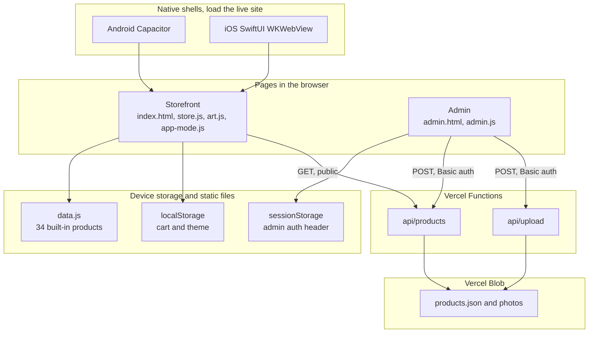
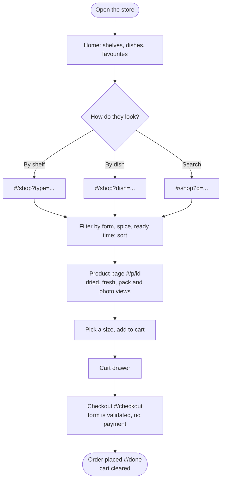
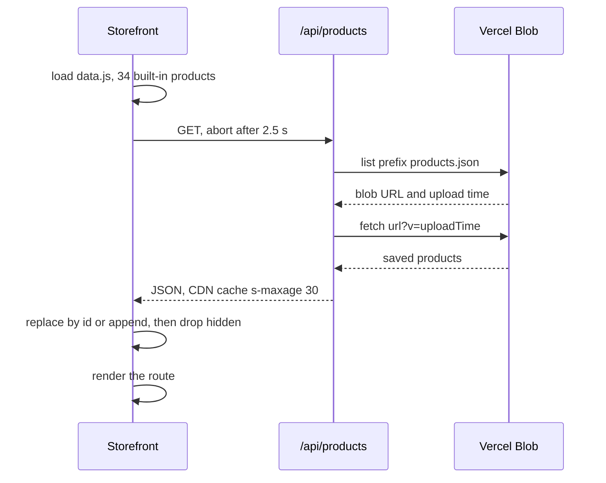
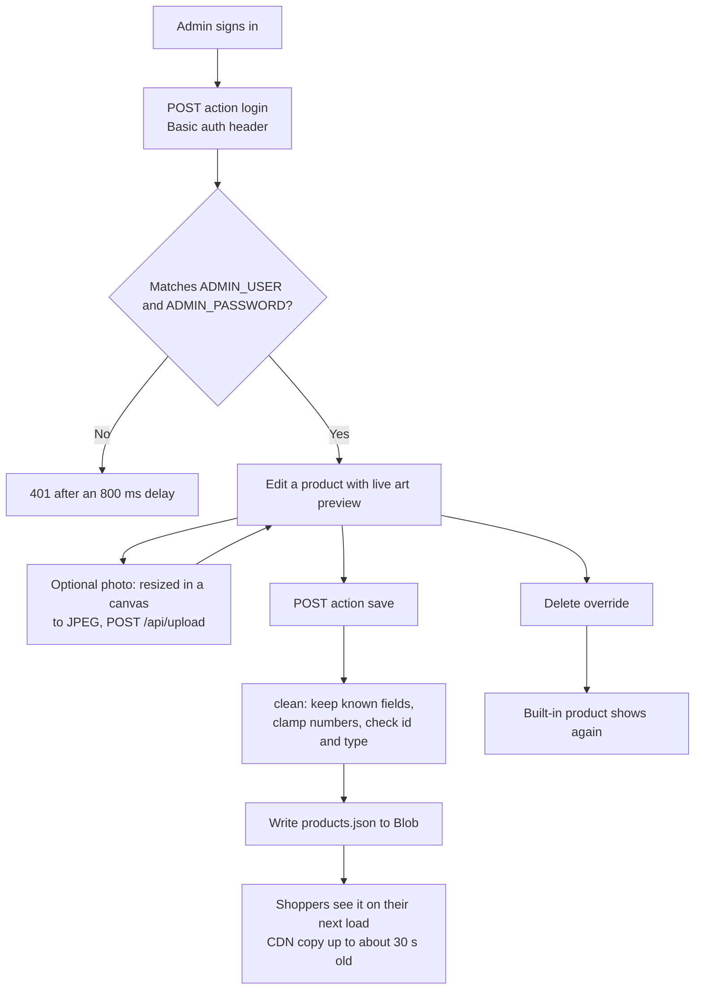
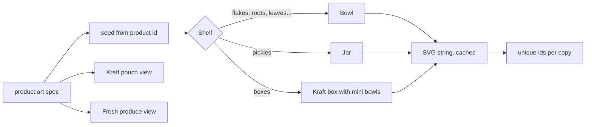
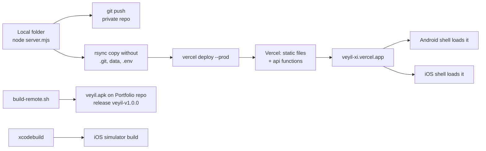

# Veyil: architecture

Veyil (வெயில், "sunlight") is a storefront for solar-dried vegetables, leaves, pickles and vathal, with a small admin for managing products. It is plain HTML, CSS and JavaScript with no build step. The main idea: every packshot is drawn in code from a short product spec, so a new product needs no photography, and a catalogue built into the page is overridden by whatever the admin saves, so the store still works on plain static hosting with no server at all.

| Platforms | Stack | Data | Hosting |
| --- | --- | --- | --- |
| Web storefront and admin; Android app (Capacitor, loads the live site); iPhone app (SwiftUI WKWebView shell). The apps are the shopper store only. | Vanilla JS with a hash router, Kolam design tokens, two Vercel Functions (Node), `@vercel/blob` | 34 built-in products in `data.js`, plus admin edits stored as one JSON file in Vercel Blob; cart and theme in localStorage | Vercel project `veyil` at veyil-xi.vercel.app, deployed with the Vercel CLI (not git-connected) |

## System architecture

The browser loads one page, `index.html`, and five classic scripts in order: `credits.js`, `data.js`, `art.js`, `app-mode.js` and `store.js`. `store.js` first asks `/api/products` for admin changes (it gives up after 2.5 seconds), merges them into the built-in catalogue by product id, then renders every view itself.

The admin page (`admin.html` + `admin.js`) talks to the same two functions with HTTP Basic auth. On Vercel the functions keep data in Vercel Blob; on a laptop, `server.mjs` runs the same handlers and writes to a local `data/` folder.

*Everything runs in the page except two small functions. The admin is not linked from the native apps.*

## Main user flow

The core job is: find a dried product, understand what it replaces and how to cook it, and add it to the cart. The store is organised three ways: by what it is (seven shelves: flakes, powders, roots, leaves, pickles, vathal, boxes), by dish (eight dishes such as kuzhambu and rasam), and by filters for form, spice and ready-without-soaking.

*Routes are hash routes handled by `route()` in `store.js`.*

Checkout is a demo. The form is validated in the browser, then the cart is cleared and the thank-you page is shown. No order or personal data leaves the device, and the page says so.

## Data flow and state

Two flows matter: how the storefront builds its catalogue, and how an admin change reaches shoppers.

*If the request fails or times out, the store silently uses the built-in catalogue.*

### Admin save and override

*A saved product whose id matches a built-in one replaces it. Deleting that saved copy restores the original, which is how "Reset to original" works.*

| State | Where it lives | Notes |
| --- | --- | --- |
| Built-in catalogue | `data.js` (TYPES 7, DISHES 8, PRODUCTS 34) | Shipped with the page; the source of truth when no API is reachable |
| Admin products and overrides | `products.json` in Vercel Blob (public), or `data/products.json` locally | One JSON array; each item is cleaned on save and stamped `admin: true` and `updated` |
| Uploaded photos | Blob `photos/<name>-<random>.<ext>`, or `data/uploads/` locally | JPEG, PNG or WebP, up to 4 MB |
| Cart | localStorage `veyil.cart` | Lines whose product no longer exists are dropped on load |
| Theme | localStorage `veyil.theme` | Only set when the shopper switches; otherwise follows the system |
| Admin session | sessionStorage `veyil.admin` | The Basic auth header for this tab only; cleared on sign-out or any 401 |

## Key modules

| File / module | Responsibility |
| --- | --- |
| `index.html` | Shell: header, mega menu, type strip, `<main>`, footer, cart drawer, credits dialog, shared SVG filters; loads the Kolam M3 and iOS kits from the Kolam site |
| `store.js` | Async IIFE: fetches admin products, merges them, theme, cart, search suggestions, mega menu, the router and all views (home, shop, product, story, checkout, done) |
| `data.js` | Catalogue: shelves, dishes, 34 products with price, weight, spice, soak time, fresh equivalent, steps and an `art` spec; `NOT_FRESH` lists reference photos that show dried product |
| `art.js` | Procedural packshots: `Art.dried`, `Art.pack`, `Art.fresh`; seeded random per product id, so a product always looks the same |
| `credits.js` | Credits for the 16 Wikimedia Commons reference photos in `img/` |
| `app-mode.js` + `app-mode.css` | Native looks inside the apps: tab bar or navigation bar, titles, back, cart badge; hides the website header and footer columns |
| `admin.html` + `admin.js` + `admin.css` | Product list, editor with live preview of all art views, image resize and upload, hide, delete and reset |
| `api/products.js` | GET public list; POST `login`, `save`, `delete` (admin only); validates and normalises every field |
| `api/upload.js` | POST image bytes, admin only; checks type and size |
| `api/_store.js` | Blob or local-file storage, image saving, Basic auth with constant-time compare |
| `server.mjs` | Local dev server on port 5310: static files plus the same API handlers; blocks `.env`, `.git`, `api/`, `node_modules` |
| `tools/shots.mjs` | Headless Chrome screenshots for the portfolio card |

### Procedural packshots

Each product carries an art spec (piece type such as flake, ring or leaf, up to four colours, background, and flags). `art.js` turns the product id into a seed, scatters pieces into a bowl, jar, pouch or kraft box, and returns an SVG string. `store.js` caches the string and rewrites its gradient ids for every copy on the page, because a copy hidden inside the mega menu would otherwise own the ids and grey out the visible ones. A product with an uploaded photo shows the photo instead.

*Same seed, same picture, everywhere the product appears.*

## Platforms

| Platform | How it is built | Look |
| --- | --- | --- |
| Web | The live site in any browser | Kolam design system, primary colour re-themed to chilli `#b5401b`; light and dark |
| Android | Capacitor shell in `android-wrappers/veyil`, app id `com.gopinath.veyil`. Remote: `server.url` is the live site; the user agent gets `Veyil-Android`. `MainActivity` is the default `BridgeActivity`. | Material Design 3 via the Kolam M3 kit (`html.k-android`): top app bar, navigation bar with Home, Shop, Dishes and Our story, cart action |
| iPhone | SwiftUI app in `Veyil-iOS` (public repo `tgopinath/Veyil-iOS`): a WKWebView on the live site, user agent `Veyil-iOS/1.0 Kolam-iOS/1.0`, `window.KolamShell` injected at start, edge-swipe back, haptics message handler, outside links in Safari view, offline retry | Apple HIG via the Kolam iOS kit (`html.k-ios`): large titles, tab bar, back with centred title, cart action |

Both shells load the live website, so a web deploy updates the apps too. In the apps the website header, ribbon, breadcrumbs and footer columns are hidden, search moves to the top of Home and Shop, and there is no admin link. If both kits could switch on, iOS wins.

## Data sources and APIs

| Source | Used for | Licence / key |
| --- | --- | --- |
| Hand-written catalogue (`data.js`) | Products, shelves, dishes, prices (illustrative), soak times, fresh equivalents | Own content |
| Wikimedia Commons (16 photos in `img/`) | Reference photos of fresh produce | Per-photo licences listed in `credits.js` and in the in-app Photo credits dialog |
| Vercel Blob | Admin products and uploaded photos | Env var `BLOB_READ_WRITE_TOKEN` (set in Vercel) |
| Admin login | HTTP Basic auth on POST routes | Env vars `ADMIN_USER`, `ADMIN_PASSWORD` (Vercel env, or `.env.local` locally, git-ignored) |
| Kolam design system site | Tokens (copied into `kolam/`), M3 and iOS kits (loaded from tgopinath.github.io) | Own design system |
| Google Fonts | Lato and Noto Sans Tamil | Open font licence |

## Offline, performance, privacy and accessibility

- **Offline:** there is no service worker or web manifest, so the website does not work offline. The iOS shell shows a retry screen when loading fails. Not verified from code: any offline behaviour in the Android shell beyond Capacitor defaults.
- **Resilience:** the API is optional. A 2.5-second timeout and a silent catch mean the store renders from `data.js` if the function is slow or missing. localStorage reads and writes are wrapped in try/catch.
- **Caching:** `vercel.json` sends `no-cache` for the HTML, JS and CSS files; script tags carry `?v=N` for cache-busting. The public product list is CDN-cached for 30 seconds with stale-while-revalidate, and the admin bypasses it with a timestamp query.
- **Privacy:** checkout collects nothing; the form never leaves the page. There are no analytics or third-party trackers in the code. The admin page is marked `noindex`.
- **Security:** POST routes need Basic auth checked against env vars with a SHA-256 plus `timingSafeEqual` compare, and a failed attempt waits 800 ms. Every saved field is whitelisted, length-limited and clamped; image URLs must be https or a local uploads path; uploads are limited to JPEG, PNG or WebP up to 4 MB. All rendered text goes through an `esc()` helper.
- **Accessibility:** skip link, landmark navs with labels, `aria-expanded` on the mega menu, a live region for the cart count and toasts, focus moved to `<main>` on every route, labelled form fields with an error message in a `role="alert"` element, spice level spoken as "Spice n of 3". Decorative SVGs are `aria-hidden`.

## Build and deploy

The GitHub repo `tgopinath/veyil` is private, and the Vercel project is not connected to it, so a push does not deploy. Production is deployed with the Vercel CLI from a copy of the folder that leaves out `.git`, `.claude`, `data/` and `.env*` files. `vercel.json` sets no framework, no build command and output directory `.`, so Vercel serves the files as they are and treats `api/` as functions. (The storefront script is called `store.js` because Vercel treated a root `app.js` as a server.)

*The APK is attached to the public Portfolio repo release because the app repo is private.*

## Known limits and next steps

- Checkout is a demo: no payment, no order record, no email or WhatsApp message.
- Prices, stock and ratings are illustrative.
- One admin account from env vars, sent as Basic auth on every request; there is no rate limit beyond the 800 ms delay, and no audit log.
- All admin products live in one JSON file, so two admins saving at once could overwrite each other.
- No service worker, so no offline store or installable PWA.
- Deploys are manual CLI runs; connecting the Vercel project to GitHub would make a push deploy.

---

Written from the source code on 17 November 2026. Source: private repo tgopinath/veyil.
